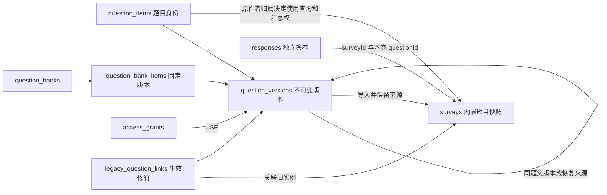

# 第二阶段需求分析与数据库设计

本文记录第二阶段已实现的设计，保留D10—D14备选比较、Q01—Q09决策及其演化依据。八项需求已实现，2026年10月29日完整回归169项通过；实际模块、路由、测试及浏览器检查见[项目完成报告第10节](项目完成报告.md#phase2)。下文示例是设计片段，具体可执行验证器见[mongodb-schema.json](mongodb-schema.json)。第二阶段人工抽样验收已结束，范围见报告第10.7节；k=5按P018作为建议参数实现，未记作最终确认。第一阶段标签、原数据及ZIP保持不变。

继续保留原有模块化单体和问卷内嵌快照，在其外围增加题目、版本、授权和题库管理。答卷继续指向当时的问卷题目实例；题目库更新不能改变已发布问卷，也不能重新解释旧答案。

- [需求覆盖与现有实现](#requirements)
- [D10—D14备选](#decisions)
- [集合与核心文档](#model)
- [索引与一致性](#indexes)
- [历史兼容](#compatibility)
- [模块与接口](#implementation)
- [实现与验证状态](#testing)
- [最终业务决策与参数复核](#confirmation)

## 1 依据与第一阶段基线

需求来源为课程原始附件《大作业一：需求变更.docx》，文件SHA256为`d9e5bdd8594810923570495cb22b0d8a992889fff9b140e1607c700cb008df1d`。下文按Word的“一”至“八”标记来源，不推测页码。原作业还要求沿用第一阶段工程，说明数据结构和程序的变化、兼容问题、测试及AI使用过程；两个阶段都要提交可运行代码、Schema、系统与API说明、测试用例和完成报告。

审查基线为提交`16bd17bc76e6ab6eefcaffb5a1c8f71ffe666e6a`及标签`phase1-submit-20261022-r1`。现存第一阶段ZIP名为`MongoDB问卷系统_第一阶段.zip`，SHA256为`3fdb09781a15a5f15e33a48fa4cf0424a730e912e1ba2f306fd5aa0f254e0848`；本轮保留现有名称和文件内容。

第一阶段冻结基线为126项后端测试、6项HTTP检查、18项DOM检查通过，app行覆盖率765/794，即96.35%。第二阶段2026年10月23日完整回归166项通过，10月29日新增3项权限测试后完整回归169项通过；网页检查仍引用10月23日记录。M01—M03是第一阶段已记录的浏览器人工验收，其余未执行项目和C01—C03代码复核继续保持原状态。

<a id="requirements"></a>

## 2 八项需求覆盖与变更分析

| 编号及Word来源 | 明确要求 | 第一阶段情况 | 数据库与业务改动 | API和前端改动 | 核心验收 |
| --- | --- | --- | --- | --- | --- |
| S2-R01 一 | 独立保存题目；新问卷选用；同题用于多问卷 | 只有surveys.questions，没有独立题目身份 | 增加题目根和版本；导入生成新的问卷内实例，保存来源与完整快照 | 我的题目、题目编辑、从已有题目选用；创建和导入接口 | 同一版本导入A、B后实例ID不同，来源版本相同，均能填写统计 |
| S2-R02 二 | 共享给其他账号，对方用于自己的问卷；原作者仍可使用 | shareSlug只提供填写入口，不能用于题目授权 | 增加按账号授权；复用不转移所有权；修改他人题目须另存并记录来源 | 共享、收到的题目、撤销授权及另存为我的题目 | A共享给B，B可导入；C不可访问；A继续使用；B不能覆盖A的版本 |
| S2-R03 三 | 已发布题目不能被改动，修改生成新题，旧问卷保持原内容 | 已冻结发布定义，具有可复用基础 | 保留问卷快照；目录版本不反向更新问卷；改题生成新的版本文档或新题目根 | 发布页保持只读，草稿明确选择替换版本 | 更新目录、恢复版本、改题库引用后，旧问卷题干、选项、规则、答卷和统计不变 |
| S2-R04 四 | 查看历史，知道从哪个题改来，可恢复旧版本 | contentVersion固定1，不能表示题目版本历史 | parentVersionId、derivedFromVersionId和restoredFromVersionId分别记录关系；恢复生成新记录 | 版本列表、逐版正文与约束、来源和恢复确认 | v1→v2→v3后恢复v1得到v4，v1—v3仍存在，恢复来源可查 |
| S2-R05 五 | 基于旧题创建新版本；版本分别修改、并用于不同问卷 | 无独立版本链 | 每个已保存版本有独立ID；可从非最新版本分支；编辑中的工作稿不影响已保存版本 | 选用时显示确切版本，支持从指定版本开始编辑 | A固定v1，B固定v2；后来新增v3，两问卷仍保留原内容 |
| S2-R06 六 | 查询题目被哪些问卷使用；修改时决定是否建新版本 | questionId仅在一份问卷内有意义 | 原作者按根查询各版本使用实例，返回固定展示标识、版本、状态；不开放整卷或答卷 | 使用情况列表、导入告知、版本/状态展示及分页 | 一卷两实例不漏报；“不增版”仅限工作稿；撤销后既有使用记录保留 |
| S2-R07 七 | 建立和管理题库、加入题目、从题库选题、更新版本 | 没有题库 | 题库元数据与成员分开；成员固定到版本；更新成员不推送到已选问卷 | 题库列表、成员增删和指定版本更新、选题器 | 一个版本可入多个题库；题库改指v2后原问卷仍使用v1 |
| S2-R08 八 | 查看单题跨问卷回答情况，示例包括年龄总体分布 | 统计按surveyId和contentVersion过滤 | 原作者自动汇总全部有效采用实例及旧题有效关联，不逐卷授权；按版本、隐私门槛及有效回答聚合 | 单题跨卷统计、固定数值分组及低样本提示；保留原问卷内统计 | 无AGGREGATE授权也能汇总；低样本隐藏、跨版本分开，旧题关联不重复计数 |

已确定：“不增版修改”只适用于工作稿；已保存版本的修改与恢复均创建新版本。共享限指定版本，题库先做个人管理，不混算不同版本，不推断跨问卷独立人数。使用清单、原作者汇总权和旧题关联按Q05、Q07、Q09的最终规则执行。

### 2.1 模块复用与扩展结果

| 现有位置 | 保留的能力 | 已实现扩展与边界 |
| --- | --- | --- |
| [domain.py](../app/domain.py) | 四题型校验、Decimal128精度、优先级与仅向后跳转、保守清理、答案打包 | library_service复用题型校验；来源字段不参与路径计算，规则引擎保持原实现 |
| [survey_service.py](../app/survey_service.py) | ownerId管理权限、草稿CAS、发布冻结、关闭和截止 | version_check现明确支持问卷结构1/2；导入和替换仅允许草稿 |
| [attempt_service.py](../app/attempt_service.py) | 登录后填写、草稿恢复、正式提交幂等、D09-B、单账号唯一约束 | 仍只读取问卷快照，不在填写/提交时取题库“最新版本”；答卷不用改成引用题库版本 |
| [models.py](../app/models.py)、[schema.py](../app/schema.py) | 严格字段、类型、原四集合验证器和索引 | 原验证器不变；library_models定义新DTO，runtime_schema严格区分surveys v1/v2，其余旧集合保持1 |
| [repositories.py](../app/repositories.py) | BSON转换、通用读取/插入、按revision更新 | 新服务通过原Store访问集合；运行启动使用ensure_runtime_schema，原ensure_schema保留供四集合基线 |
| [stats_service.py](../app/stats_service.py)、[security.py](../app/security.py) | 问卷内统计、正式状态过滤、匿名输出、十进制结果 | library_stats独立实现跨卷聚合；respondentKey含surveyId，不用于计算跨卷全局人数 |
| [editor.js](../app/static/editor.js)、[app.js](../app/static/app.js) | 题型/规则控件、同源导航、保存和错误提示 | 已增加选题和来源展示；以白名单DTO保存，服务端保留可信来源并检查正文签名 |
| [filler.js](../app/static/filler.js)、[stats.js](../app/static/stats.js) | 填写与问卷内统计页面 | 保留原流程；填写接口只返回必要快照，不返回目录来源或共享授权信息 |
| [history_baseline.py](../scripts/history_baseline.py)、[conftest.py](../tests/conftest.py) | 原始BSON和固定统计验证、隔离数据库 | 旧verify仍要求恰好四集合；新增兼容核验明确十集合，env按十集合清理 |

<a id="decisions"></a>

## 3 D10—D14关键设计备选

保留设计阶段D10—D14各三种备选比较；A方案已确认并实现，其中D12、D14的权限范围按P017确认的Q05/Q07调整。复杂度和性能比较仍为结构分析，尚无第二阶段压测结果。最终选择及理由见第3.6节。

### D10 独立题目和问卷的关联

| 方案 | MongoDB建模与一致性 | 实现和性能 | 历史兼容及取舍 |
| --- | --- | --- | --- |
| A 题目根＋独立版本＋问卷内嵌快照及版本引用 | 题目根表示身份，版本文档保存不可变内容；问卷单文档保存实际题意和来源 | 中等工作量；目录维护有引用检查，填写不增加lookup；快照有受控冗余 | 最接近原模型，旧题继续无来源读取；推荐 |
| B 问卷仅引用不可变题目版本 | 存储冗余少，必须保证版本永不覆盖且不硬删除 | 读问卷需查多个版本，缺失版本影响填写；规则仍须放在问卷实例中 | 要改写现有定义读取和答卷解释路径，旧问卷需适配；当前不推荐 |
| C 题目根内嵌所有历史版本，再供问卷引用/复制 | 单题版本变更可在一个文档内操作 | 起步简单，但版本数不断增长，分页、并发及文档大小会逐渐受限 | 兼容可以实现，长期增长边界较差；仅有明确小上限时考虑 |

推荐A。题干、题型、必答、选项和约束组成版本内容；order、questionId和跳转rules属于问卷实例。跳转目标引用本问卷的题目，不能直接复制到另一问卷。导入时生成新的实例questionId，保留该版本的optionId，规则初始为空；导入后仍由问卷配置跳转。Q01已确定正文固定，不允许本地覆盖后仍保留原版本来源。

### D11 创建、修改、恢复与来源

| 方案 | 一致性与版本关系 | 复杂度/性能 | 兼容和建议 |
| --- | --- | --- | --- |
| A 工作稿可修改，保存的版本不可变；恢复另建版本 | parent指同题基线；另存新题记录外部来源；恢复不覆盖旧文档 | 中等；多存少量内容，但历史查询直接。版本号分配和默认版本指针需要CAS及重试 | 旧问卷自然保持不变，已采用；“不增版”限工作稿编辑，Q02已确认 |
| B 从未被使用的版本允许原地修改，一旦引用即冻结 | 需严密判断“使用”，包括题库、草稿问卷及他人导入 | 中高；并发导入与修改之间存在跨文档检查窗口，严格语义需额外锁定协议或事务 | 用户选择接近直觉，但同一个版本ID可能曾有不同内容，历史审计更难 |
| C 只保存修改事件，读取时重放出各版本 | 来源和操作记录完整 | 高；恢复、删除、缓存和快照重建都增加负担 | 原系统是完整文档模型，迁移和调试成本高，暂不推荐 |

推荐A，并保留从旧版本分支的能力。例：v1→v2→v3，恢复v1生成v4，v4.parentVersionId=v3，v4.restoredFromVersionId=v1；若“基于v1另建一个分支”，新版本parentVersionId=v1，操作类型不同。另存到其他账号名下时新建题目根，以derivedFromVersionId保存来源，不能把新所有者的修改并入原作者版本链。

父版本必须先存在且属于同一题目根，禁止跨题父引用或环；派生来源另行保存。知道来源ID不等于获得来源正文读取权，未授权的祖先版本不能通过历史接口绕过授权。

恢复只创建题目版本并更新默认选择，不修改任何问卷和题库成员。相同内容的v1与恢复版可以具有相同contentHash，但版本ID仍不同，contentHash不能设为唯一。

### D12 共享与权限

| 方案 | 权限和一致性 | 复杂度/性能 | 取舍 |
| --- | --- | --- | --- |
| A 向指定账号授予指定版本的读取/使用权 | 原作者独占原题编辑权；接收者可用同一版本，修改则另存新题并保留来源 | 中等；版本/账号索引定位授权，撤销不追写问卷 | 权限范围明确，不自动包含以后版本；推荐 |
| B 向账号共享整道题及未来版本，可再增加协作编辑角色 | 使用更方便，必须细分读取、使用、编辑及授权管理 | 较高；多账号写入、历史可见性和默认版本竞争更多 | 适合真正的团队共同维护，但Word未明确要求共同编辑 |
| C 公共题目市场，所有登录者读取后复制 | 授权查询简单，但公开范围明显扩大 | 简单到中等；来源复制和撤回语义仍需处理 | 可作为以后选项，不能替代按账号共享 |

采用A。USE只授予读取和复用指定版本的权利，填写链接不构成题目授权。原作者查看该题使用信息及汇总是Q05/Q07规定的作者权利，不另发统计授权。撤销USE阻止此后新受理的读取、入库选题和导入；已导入的草稿、发布快照、使用记录及其后续正式回答继续适用原告知规则。并发操作按服务端检查时刻受理，不声称撤销与另一文档写入原子完成。

### D13 题库及成员版本

| 方案 | 建模及更新 | 复杂度/性能 | 建议 |
| --- | --- | --- | --- |
| A 题库元数据＋独立成员集合，成员固定版本 | 每条成员对应一个版本；更新是显式换绑，不推送问卷 | 中等；成员和题库可分别索引、分页，避免无限数组 | 推荐；同题多个版本可以并存，确切版本不重复加入同一库 |
| B 题库内嵌有上限的成员数组 | 同一题库一次读取/原子改成员方便 | 低到中等；需要明确成员上限，整库竞争和分页较弱 | 小题库可用；不得声称可无限增长 |
| C 成员只指题目根，始终跟随默认版本 | 更新默认版本后所有题库显示新内容 | 实现较少，但选题结果随时间改变，不能直观看出历史固定版本 | 即使问卷快照仍安全，题库语义也较隐蔽；不推荐默认采用 |

采用A，已实现个人题库。可以加入本人版本和获使用授权的版本；题库归属不能扩大题目权限，撤销授权后该成员不可用于新的导入。题库成员升级不更新已有问卷；需要升级某份草稿时由创建者另行确认。Q06已确定只做个人题库，不增加协作角色。

### D14 跨问卷统计

| 方案 | 版本范围与权限 | 聚合及计数 | 成本和建议 |
| --- | --- | --- | --- |
| A 默认按确切版本统计，跨版本分别展示 | 原作者自动覆盖全部采用实例；其他账号只统计自有问卷；不开放他人答卷 | 实时聚合正式答案，执行统一低样本量规则；回答实例和答卷数分开，不提供全局匿名人数 | 中等；无需逐卷授权及统计计数副本，已采用 |
| B 同题多个版本按明确的兼容映射合并 | 须选择版本，明确题意、单位、选项语义和权限 | 对应选项及数值单位后再汇总，保留逐版本结果 | 较高；仅版本号相邻、题干相同或哈希相同都不能自动代表可混算 |
| C 预计算统计集合，并建立跨卷身份标识 | 还需独立的数据授权与新身份规则 | 查询快，但需处理提交幂等、授权变更、撤销、回填和重建 | 高；会扩大隐私及迁移范围，当前不推荐 |

采用A。接口支持选择多个确切版本分别返回结果，网页当前按单版查询。一个版本在多份问卷使用可以合并；不同根的题目即使同名、同哈希或来自同一祖先，也不自动混算。本人问卷可保留原频数和均值；跨账号汇总提供固定分组分布，并执行第5.3节的低样本量规则，覆盖Word“年龄总体分布”示例。Q07/Q08已确定不跨版本混算、不做匿名全局人数去重。

### 3.6 最终决策及选择理由

以下方案在AI使用记录P017中确认，P018记录了后续实现与测试。当前工程已按这些决策完成开发；人工验收和隐私参数复核的状态见第9.1节。

| 决策 | 最终方案 | 选择理由与已确认调整 |
| --- | --- | --- |
| D10 | A | 复用原问卷内嵌快照和答卷结构；库题根与不可变版本负责复用和追溯，不改变旧题意 |
| D11 | A | 工作稿可改、保存版本不覆盖；修改/恢复均新增版本，来源和分支关系可追溯 |
| D12 | A | 指定账号、指定版本USE；接收者可复用/另存，不可改原题；原作者按统一告知规则获得使用信息及汇总 |
| D13 | A | 个人题库和成员独立存储、固定版本；升级不推送问卷，避免无限成员数组 |
| D14 | A | 正式答卷实时聚合、默认确切版本；原作者汇总全部采用实例，不逐卷授予AGGREGATE；用固定范围和低样本量规则控制披露 |

<a id="model"></a>

## 4 集合和文档关系

### 4.1 十集合结构

保留四集合职责，新增六集合。新集合不是将问卷重新拆成关系表：有界的题目内容、选项与规则仍在文档内部；版本历史、授权和题库成员等可持续增长、多对多且独立查询的关系才拆开。

关系数据库也能用题目、版本、实例和选项表实现这些需求，但需要更多关联读取。本项目要求MongoDB，且已有完整内嵌定义，因此继续将一起读取的题意放在同一文档，保留单份问卷的读取和修改边界；引用之间的一致性则由应用和索引共同维护。现有每卷200题、每题100选项和50条规则、单文档2 MiB的应用限制保留，批量选题后仍须校验总大小。

| 集合 | 存储内容与边界 |
| --- | --- |
| users | 原账号、密码散列；保留schemaVersion=1 |
| sessions | 原登录会话；保留schemaVersion=1及TTL |
| surveys | 原问卷与完整questions快照；新结构可有sourceRef，已发布内容仍冻结 |
| responses | 原答卷与questionId答案；继续独立存储，不复制全部版本定义 |
| question_items | 题目根：ownerId、管理名称、状态、默认版本指针、版本号分配和至多一份工作稿 |
| question_versions | 每个已保存版本一份不可变内容，含父版本、另存来源、恢复来源、内容哈希及固定汇总分组策略 |
| access_grants | 仅管理指定版本对指定账号的USE权及撤销；不存统计或问卷访问授权 |
| question_banks | 个人题库名称、说明、ownerId、状态、revision；不内嵌无限成员 |
| question_bank_items | bankId、libraryQuestionId、questionVersionId、顺序和revision；固定确切版本 |
| legacy_question_links | 旧实例关联；同集合存HEAD和不可变REVISION，只有HEAD指向的修订生效，旧BSON不变 |

Q09已启用legacy_question_links，不再作为可选集合。HEAD是每个旧实例的当前指针，REVISION保存关联/纠错事实；两种记录在同一集合校验，不另建使用记录副本、统计授权集合或统计缓存集合。



### 4.2 标识和版本不能混用

| 名称 | 含义 |
| --- | --- |
| libraryQuestionId | 题目根ObjectId；表示同一道库题的身份，不表示某次问卷里的题 |
| questionVersionId、versionNo | 不可变版本ObjectId及该题内显示编号；分支按父ID追踪，不能仅按编号推断父子 |
| surveys.questions.questionId | 保留原字段，是问卷内的实例ID；唯一键在概念上是surveyId＋questionId |
| optionId、ruleId | 选项含义和本卷规则标识。跨版本选项含义改变时不能仅凭ID强行合并统计 |
| schemaVersion | 文档结构版本。原数据保留1，草稿首次导入库题时转为2；新集合自身的首个结构版本为1 |
| contentVersion、ruleLanguageVersion | 原问卷内容/规则解释版本，第一阶段均为1；不是题目库的versionNo。冻结问卷不因题库出新版而递增 |
| identityKeyVersion、revision | 原身份算法版本和并发修订号；后者不是业务内容版本 |

版本引用用于追溯、选题和跨卷统计；问卷快照才是填写、校验、跳转和解释历史答案的依据。新答卷仍可使用schemaVersion=1及原答案形状，只需版本分派允许它引用支持的schemaVersion=2问卷。

### 4.3 核心字段示例

以下均为合成的核心字段片段，省略未变化的公共字段，不是已入库数据或可直接导入的完整文档。ID采用Extended JSON表示。

题目根和首个版本：

```json
{
  "question_items": {
    "_id": {"$oid": "400000000000000000000001"},
    "ownerId": {"$oid": "100000000000000000000001"},
    "name": "年龄题",
    "status": "ACTIVE",
    "headVersionId": {"$oid": "500000000000000000000001"},
    "nextVersionNo": 2,
    "workingDraft": null,
    "revision": 1,
    "schemaVersion": 1
  },
  "question_versions": {
    "_id": {"$oid": "500000000000000000000001"},
    "libraryQuestionId": {"$oid": "400000000000000000000001"},
    "versionNo": 1,
    "parentVersionId": null,
    "derivedFromVersionId": null,
    "restoredFromVersionId": null,
    "operation": "CREATE",
    "operationKey": "example-create-age-v1",
    "summaryPolicy": {"policyVersion": 1, "numericCuts": ["24", "48", "72", "96"]},
    "payload": {
      "title": "你的年龄",
      "type": "NUMBER",
      "required": true,
      "options": [],
      "constraints": {
        "minSelections": null, "maxSelections": null,
        "minLength": null, "maxLength": null,
        "minValue": "0", "maxValue": "120", "integerOnly": true
      }
    },
    "createdBy": {"$oid": "100000000000000000000001"},
    "schemaVersion": 1
  }
}
```

版本还需保存createdAt及contentHash。哈希按经过规范化的payload计算，排除时间、来源、order、rules及本卷questionId；默认约束补全、键排序和字符编码需固定。阈值和答案不经float转换。哈希用于校验快照，不能代替业务身份或授权。

非空workingDraft保存baseVersionId、payload及工作稿修订信息，用于明确“正在从哪个版本修改”；保存新版本时仍以指定基线为父版本，不从当前列表顺序推测。

两份问卷中的题可分别叫`q_age_a`、`q_age_b`；来源相同而实例不同。问卷和答卷片段：

```json
{
  "survey": {
    "_id": {"$oid": "200000000000000000000002"},
    "schemaVersion": 2,
    "contentVersion": 1,
    "ruleLanguageVersion": 1,
    "questions": [{
      "questionId": "q_age_a", "order": 0,
      "title": "你的年龄", "type": "NUMBER", "required": true,
      "options": [],
      "constraints": {
        "minSelections": null, "maxSelections": null,
        "minLength": null, "maxLength": null,
        "minValue": "0", "maxValue": "120", "integerOnly": true
      },
      "rules": [],
      "sourceRef": {
        "libraryQuestionId": {"$oid": "400000000000000000000001"},
        "questionVersionId": {"$oid": "500000000000000000000001"},
        "reusePolicyVersion": 1,
        "acknowledgedAt": {"$date": "2026-10-22T00:00:00Z"}
      }
    }]
  },
  "response": {
    "surveyId": {"$oid": "200000000000000000000002"},
    "schemaVersion": 1, "contentVersion": 1, "identityKeyVersion": 1,
    "status": "SUBMITTED",
    "answers": [{"questionId": "q_age_a", "numberValue": {"$numberDecimal": "19"}}],
    "visitedQuestionIds": ["q_age_a"]
  }
}
```

实际sourceRef还需contentHash；reusePolicyVersion和acknowledgedAt记录复用告知，时刻由服务器生成。版本的summaryPolicy固定数字切点，policyVersion引用服务端统一隐私规则，客户端不能降低门槛。summaryPolicy也不可覆盖，但不纳入题目正文的contentHash；关联者须在告知页看到相应分组与披露范围。来源和内容由服务器读取有权使用的版本后生成；草稿也不能一面改正文、一面保留旧版本引用。

题库与成员片段：

```json
{
  "question_banks": {
    "_id": {"$oid": "600000000000000000000001"},
    "ownerId": {"$oid": "100000000000000000000002"},
    "name": "常用基础题", "status": "ACTIVE", "revision": 0, "schemaVersion": 1
  },
  "question_bank_items": {
    "_id": {"$oid": "610000000000000000000001"},
    "bankId": {"$oid": "600000000000000000000001"},
    "libraryQuestionId": {"$oid": "400000000000000000000001"},
    "questionVersionId": {"$oid": "500000000000000000000001"},
    "position": 10, "revision": 0, "schemaVersion": 1
  }
}
```

共享记录仅表达USE，不再保存AGGREGATE或VIEW_USAGE授权：

```json
{
  "_id": {"$oid": "620000000000000000000001"},
  "questionVersionId": {"$oid": "500000000000000000000001"},
  "granteeId": {"$oid": "100000000000000000000002"},
  "grantedBy": {"$oid": "100000000000000000000001"},
  "active": true, "revision": 0, "schemaVersion": 1
}
```

还需createdAt、updatedAt和撤销时刻。授权者必须是该题目根的ownerId；active=false只撤销新的USE受理。作者汇总权由question_items.ownerId推导，不发授权文档，也不允许借题库成员或祖先来源扩大权限。

旧实例关联的两类核心记录如下；此处仍为合成片段，不对应现有历史基线中的实际问卷：

```json
[
  {
    "_id": {"$oid": "700000000000000000000001"},
    "recordType": "HEAD",
    "surveyId": {"$oid": "200000000000000000000003"},
    "questionId": "q_age_legacy",
    "currentRevisionId": {"$oid": "710000000000000000000001"},
    "revision": 1, "schemaVersion": 1
  },
  {
    "_id": {"$oid": "710000000000000000000001"},
    "recordType": "REVISION",
    "headId": {"$oid": "700000000000000000000001"},
    "surveyId": {"$oid": "200000000000000000000003"},
    "questionId": "q_age_legacy", "surveyContentVersion": 1,
    "libraryQuestionId": {"$oid": "400000000000000000000001"},
    "questionVersionId": {"$oid": "500000000000000000000001"},
    "previousRevisionId": null, "operation": "BIND",
    "operationKey": "example-bind-legacy-age",
    "linkedBy": {"$oid": "100000000000000000000002"},
    "reusePolicyVersion": 1,
    "acknowledgedAt": {"$date": "2026-10-22T00:00:00Z"},
    "schemaVersion": 1
  }
]
```

REVISION还需contentHash、createdAt及纠错原因等字段。查询只接受HEAD实际指向且校验通过的修订；历史修订和未推进指针的候选修订不能参与统计。相同旧实例始终只有一个HEAD，不存无限历史数组。

Schema草案：sourceRef要求合法根/版本ID、内容签名、reusePolicyVersion及服务器告知时刻；access_grants只校验版本USE记录；legacy_question_links按recordType使用严格oneOf分支，HEAD指针允许初始化时为空，REVISION的operation限BIND/CORRECT/SUSPEND/RESUME。跨文档引用、内容一致性和不可变性仍由服务逻辑保证，不能只靠JSONSchema。

<a id="indexes"></a>

## 5 索引、完整性和统计口径

### 5.1 核心索引

原users、sessions及responses的幂等、单次提交、正式统计索引保留。以下索引已在runtime_schema.py实现，并经真实MongoDB集成测试；原四集合基线索引保留。

| 集合 | 实际索引 | 用途及约束 |
| --- | --- | --- |
| question_items | ownerId、status、updatedAt倒序、_id倒序 | 我的题目分页；工作稿和根元数据按_id＋revision执行CAS |
| question_versions | libraryQuestionId＋versionNo唯一 | 单题版本编号不能重复；允许故障后有编号空隙 |
| question_versions | libraryQuestionId＋operationKey唯一 | 版本创建重试幂等；同一键换内容须报冲突 |
| question_versions | parentVersionId | 查询分支；另存来源保留derivedFromVersionId，当前未为其单独建索引 |
| surveys | questions.sourceRef.questionVersionId＋ownerId＋status | 按版本找使用实例，再按权限过滤，使用多键索引 |
| surveys | questions.sourceRef.libraryQuestionId＋ownerId＋status | 按题目根查询多个版本的使用情况 |
| access_grants | questionVersionId＋granteeId唯一 | 同一版本对一个账号一条当前USE记录，可撤销/重新授予 |
| access_grants | granteeId＋active＋questionVersionId | 收到的版本共享列表，不再用于逐卷统计授权 |
| question_banks | ownerId＋status＋updatedAt倒序＋_id倒序 | 我的题库列表 |
| question_bank_items | bankId＋questionVersionId唯一；bankId＋position＋_id | 避免同一版本重复入同库；成员有序分页 |
| question_bank_items | libraryQuestionId＋questionVersionId | 版本在题库内的使用/升级检查 |
| legacy_question_links | surveyId＋questionId唯一，partial为recordType=HEAD | 每个旧实例一个当前指针；版本对应关系取其生效修订 |
| legacy_question_links | surveyId＋questionId＋operationKey唯一，partial为recordType=REVISION | 关联及纠错请求幂等，不覆盖旧修订 |
| legacy_question_links | recordType＋libraryQuestionId＋questionVersionId＋surveyId＋questionId | 保留关联反查索引；当前有效实例解析从HEAD出发，按currentRevisionId用_id索引读取唯一修订，排除旧记录和未生效候选 |

不将questions数组与answers或options等另一独立数组放入同一个复合索引。跨字段查同一题目元素时使用$elemMatch或展开后匹配，不能让一个实例的根ID与另一个实例的版本ID误配。唯一多键索引不能代替文档内部questionId、optionId和ruleId的唯一性校验。[MongoDB多键索引说明](https://www.mongodb.com/docs/manual/core/indexes/index-types/index-multikey/)和[数组索引边界说明](https://www.mongodb.com/docs/manual/core/indexes/index-types/index-multikey/multikey-index-bounds/)支持这些限制。

### 5.2 不依赖复杂事务的写入边界

1. 先校验所有权、授权、父版本和请求内容，再创建不可变版本。根上用原子自增分配编号，用唯一operationKey识别重试；插入完成后才尝试CAS推进默认版本指针。允许编号空隙或“已创建分支，但默认指针未推进”，必须返回真实状态，不能假装两个文档原子成功。
2. 导入时校验版本USE和复用告知，版本已存在且不可变，服务端生成来源、告知记录和快照，再一次CAS写入整份草稿；题库成员不是问卷实例的运行时依赖。默认不维护另一个需同步的“全部使用记录”副本，直接反查问卷。
3. 草稿替换版本保留本卷questionId和顺序，检查新选项与旧规则是否冲突。无效条件/目标应阻止保存并提示修改，不能静默删除原有规则；完整定义仍要经原验证逻辑。
4. JSONSchema检查结构，不能靠immutable=true字段实现“不可修改”。版本服务只提供插入/读取；问卷继续按状态和revision冻结；测试核对前后BSON。
5. 题目和题库采用归档，成员可以移除，已保存版本不硬删除。草稿、授权和题库变更各自CAS，不引入服务拆分、消息队列或全局事务。

上述方案沿用单文档原子性；它没有跨集合强事务保证。[MongoDB原子性与事务说明](https://www.mongodb.com/docs/manual/core/write-operations-atomicity/)指出更新过滤条件可用于并发控制，多文档整体操作并不自动原子。第一阶段D09-B不改变；USE撤销采用同类受理检查边界，不引入副本集。旧题纠错同样先插入不可变修订、再单文档CAS切换HEAD。

### 5.3 跨问卷汇总权与统计口径

原作者指题目根的ownerId，该字段创建后不转移；跨账号另存产生新根，原作者不沿derivedFromVersionId取得新根的使用清单或汇总。服务端先核验题目归属，再限定该根及所选确切版本的有效采用实例：新sourceRef和生效的旧题关联均纳入，不能由客户端传入任意根或问卷ID扩大范围。请求明确指定versionIds，服务端校验其属于该根及调用方范围；界面默认选中一个确切版本，不随查询中途的默认指针变化而换版。

| 请求者 | 使用清单 | 跨卷汇总 | 完整问卷、编辑和原始回答 |
| --- | --- | --- | --- |
| 原题作者 | 该根所有版本的采用记录，按第5.4节最小投影 | 自动覆盖该版本全部有效采用实例，不需逐卷授权；他人数据执行隐私门槛 | 他人问卷仍无管理权，不返回他人答卷或文本 |
| 问卷创建者但不是原作者 | 自有问卷实例 | 自有实例；撤销USE不取消既有自有快照的统计权 | 原问卷内管理和原始回答权限保持第一阶段规则 |
| 仅有USE的其他账号 | 不因此看到别人的使用清单 | 不因此取得别人的汇总 | 无额外权限 |

基本计算规则：

- 只统计SUBMITTED、匹配问卷contentVersion及实际保留的有值答案。草稿、显式跳过和失效清理值不进入有效回答；草稿问卷可出现在使用清单，但不贡献正式统计。
- 有效回答键为(response._id, answers.questionId)。同账号允许多次填写时各次正式答卷分别计数；同版一卷两实例分别计回答，并另报按response._id去重的答卷数。提交重试不新增答卷。
- 先按(surveyId, questionId)合并来源，防止题库入口、多次选择版本、sourceRef与旧映射重叠带来重复。相同实例若出现冲突版本引用，标为数据异常并排除，不任意选择一个版本计入。
- 多选先计回答，再展开选择次数。数字使用Decimal128；合并使用数值总和/有效数，不能平均各卷均值。多版本请求返回独立组，不提供跨版本总计；同哈希恢复版和另存新根也不自动混算。
- respondentKey含surveyId，继续保留原身份算法；不把跨卷伪名、实名账号或分卷人数之和解释为全局独立人数。原作者的他人汇总中不返回账号、respondentKey、答卷ID、回答时间或单条答案。
- 数字/单选/多选只返回允许披露的汇总；他人的文本只可贡献有效回答计数，不返回文本、示例、关键词或文本频数。自有问卷仍按原接口查看原始内容和问卷内人数。

#### 低样本量保护

以下规则已按P018实施，统一k=5作为建议运行参数，尚未最终确认；由服务端策略版本控制，不能在请求参数或版本编辑中调低。

1. 每个确切题目版本划分为自有问卷部分和他人问卷部分。原作者的他人部分固定覆盖全部有效采用实例，不接受按问卷子集、答卷、任意日期或动态分桶筛选；使用清单也不返回各外部问卷的回答数量、均值或其他贡献指标。
2. 门槛按他人有效回答中不同(surveyId, respondentKey)组计，不按回答条数或实例数计。同一账号在一卷重复提交、同卷两个实例不能凑足门槛；跨卷仍可能是同一人，因此它是内部问卷内账号组门槛，不宣称全局人数或k匿名，也不对外返回该组数。
3. 他人组数不足k时，foreign和combined的精确计数、均值、分布均为null，返回INSUFFICIENT_SAMPLE；自有部分照常展示。不得把自有结果冒充“全部问卷总体”，也不返回可用总计相减还原小样本的字段。
4. 达到组门槛后，单选/多选的每个非零选项、数字每个非空分组仍须覆盖至少k个问卷内账号组。若任一非空格不满足，整个他人版本汇总及合并汇总均隐藏，返回PRIVACY_SUPPRESSED；不只隐藏一格再公开其他格和总计。零格不触发门槛。文本没有内容分组，仅检查有效回答组门槛。
5. 数字跨账号分布使用question_versions.summaryPolicy.numericCuts固定切点，不显示单值频数或他人最小/最大值。最多19个严格递增的Decimal128切点形成20档，区间为左闭右开，末档含正无穷。有限上下界可生成5档等宽候选，保存版本时固定；无上下界或切点不能无损表示时要求明确填写合法切点。不能按同一批数据任意改组；修改切点保存新版本。
6. 全部门槛通过才返回该版的他人汇总及合并计数、均值和固定分布；自有数据也按同一固定分组形成combined，避免先合并多个版本或多个小样本组再判断。空外部范围返回NO_FOREIGN_SOURCES；存在采用但零回答不额外泄露，按不足门槛处理。

这是固定查询范围和小样本抑制，不是差分隐私或不可推断保证；实时新增回答仍会改变结果。本轮不增加全局身份、噪声预算或统计缓存集合。测试须在固定数据下核对门槛前后字段及来源范围，实际阈值、重复计数、分组边界和文本禁用结果见报告第10.6节。

聚合先按responses的surveyId/status/contentVersion过滤，再unwind、精确匹配实例并group；内部账号组用group/count，不构造无限addToSet数组。旧题关联的lookup只读取HEAD所指的一条修订，不把全部答卷嵌入一个结果。当前未增加answers.questionId索引，已有explain测试仅验证代表性索引可用于查询，不表示已完成负载性能评估。[MongoDB lookup说明](https://www.mongodb.com/docs/manual/reference/operator/aggregation/lookup/)说明了关联索引对性能的影响。

实时统计不承诺多个查询间的事务快照。每次查询都重算有效来源及门槛；复用授权的撤销只影响新的USE受理，既有采用不会因此被剔除。旧题纠错是否生效取HEAD当前指针，已看过的汇总不能被后续纠错追溯撤回。

### 5.4 使用查询、复用告知与撤销

原作者可查看所有使用其版本的草稿、发布、关闭及已截止问卷，返回固定展示标识、使用版本、实例数、问卷状态和旧关联状态。默认展示标识由服务器按“题目根＋问卷”生成稳定、不含分享码的标识；同题在同卷两个实例可展开查看版本，但不暴露真实surveyId、shareSlug、问卷完整内容、创建者身份或答卷接口。

标识可用现有密钥及独立用途的HMAC生成，与respondentKey分离，不新增业务集合。根作者不能凭标识编辑或读取他人整卷；旧管理/统计接口仍须匹配surveys.ownerId。自己问卷可显示原标题；他人采用展示标识已满足“名称或展示标识”，不再增加逐卷信息授权。

导入、从题库选题、草稿替换版本及旧题关联时，界面先明确说明：原题作者可查看上述使用信息，并自动收到该版本跨卷汇总；不接收账号身份、原始答卷或文本；共享撤销后，既有快照及后续正式回答仍按原告知范围处理。使用者须确认当前reusePolicyVersion，服务器才保存sourceRef或关联修订；未确认/过期策略分别拒绝，客户端不能自报确认时刻。

撤销后不再允许新读取目录正文、新加入题库或新导入该版本；既有题库成员不可借其绕过授权。已经导入的草稿可继续发布，已发布快照、使用清单和后续汇总仍保留。另存的新根只按新根的采用范围汇总，派生关系本身不赋予原作者跨根访问权。

题目归档只阻止新采用，不删除原作者对已有使用清单、版本历史和汇总的读取权，也不硬删除旧版本。

<a id="compatibility"></a>

## 6 第一阶段兼容和迁移方案

### 6.1 结构兼容策略

采用“旧数据保留、按需增加来源”的策略，不批量把旧题推测成库题。[MongoDB结构版本模式](https://www.mongodb.com/docs/manual/data-modeling/design-patterns/data-versioning/schema-versioning/)允许一个集合保存不同结构版本；本项目通过显式验证和分派保持严格Schema。

| 对象 | 处理方式 |
| --- | --- |
| 原users、sessions、responses | 保留schemaVersion=1及原BSON；不换密钥、不重算respondentKey、不改变匿名属性和Decimal128 |
| 原已发布/关闭问卷 | 保留完整定义、questionId、optionId、rules及所有版本字段；不回填来源、不重新发布、不按当前校验器重写已冻结历史 |
| 原草稿 | 继续读取和保存；只有明确导入库题等需要新字段时，才经验证转为schemaVersion=2 |
| 新问卷 | 可使用schemaVersion=2，允许本地题和带sourceRef的库题共存；contentVersion、ruleLanguageVersion仍保持原含义 |
| 验证器 | surveys使用严格v1/v2分支，保留v1原约束；其他旧集合无需统一升2；新集合单独定义Schema |
| 版本检查 | 支持明确的旧/新组合及原规则解释，拒绝未知结构、未知规则语言或不匹配contentVersion；不改成“版本大于零都接受” |
| 无来源的老题 | 视为LEGACY_LOCAL，不因题名、ID相似或内容相同自动归为同一库题 |

源数据中的questionId只在本问卷内稳定，不能升格成全局题目根ID。把一份旧题“保存为我的题目”只产生目录版本和来源说明，不改动旧问卷。将原问卷回答关联到该版本必须由旧问卷创建者明确确认，流程见第6.2节。

### 6.2 已启用的旧实例关联与纠错

legacy_question_links独立保存关联，不给旧surveys或responses增加来源、确认字段或新修订号。为避免关联后正文继续变化，当前只接受schemaVersion=1且已发布/关闭/已截止的冻结旧问卷；旧草稿仍可另存库题和正常编辑，发布冻结后再建立历史关联。

#### 建立关联

1. 只有旧问卷创建者可申请，原题作者不能扫描或替别人绑定。申请者还须是目标版本所有者或有当前有效USE，确认第5.4节告知；仅拥有题目库或版本ID不够。
2. 服务器读取原问卷快照和目标版本，核对题干、题型、必答、选项及约束。补全约束默认值，数字阈值按无损Decimal语义比较；字典排序只用于签名，不改原BSON。标题、选项文字/顺序及optionId必须一致，数字18和18.0可判等，34位精度不得经float或有损normalize。
3. questionId、order和rules不纳入可复用内容签名；它们继续保留本卷含义，规则不会迁移到题库。选择题若只是文字相同而optionId不同则拒绝，不能偷偷按标签映射旧答案；可从该旧题保存保留原optionId的版本后再关联。
4. 不按题名自动搜索/匹配，不改题或答案以通过校验。已有sourceRef的实例不得再走旧题关联入口；目标版本归属、结构、内容及确认策略不符均拒绝。

#### 幂等和生效指针

每个(surveyId, questionId)仅一个HEAD；首次可初始化空指针。BIND请求携带operationKey及expectedLinkRevision，先插入不可变REVISION，再CAS切换HEAD.currentRevisionId并递增HEAD.revision。HEAD和修订都在新增集合中，不使用旧surveys.revision充当关联修订号。

同键同内容且当前指针仍指该修订时，重试返回同一成功结果；同键换目标或内容报409。若后来已纠错/暂停，旧请求返回409及当前关联状态，不能重放并激活旧目标。未被HEAD选中的候选修订无业务效力，重试仅在原预期仍成立时可继续CAS，否则报告冲突。只有读取到当前生效修订才能返回“关联成功”。

#### 错误关联处理

旧问卷创建者可提交带原因和预期修订号的纠错操作：SUSPEND暂停错误关联；CORRECT重新验证目标版本、内容和告知后换绑；RESUME复核后恢复同版。每次追加不可变修订、单文档CAS更新HEAD，旧修订保留，不提供删除审计记录的接口。暂停不是撤销USE，也不能改旧问卷题意或清除答卷。

SUSPEND后该旧实例退出汇总，使用查询可标为“关联暂停”；CORRECT后仅新目标为当前关系，旧目标修订不再计数。纠错原因和操作账号仅旧问卷创建者可查看，库题作者只见允许的最小使用信息。更正影响后续查询，不能收回已经披露的汇总。

使用查询和统计均从HEAD解析当前关系；候选历史修订仅用于定位HEAD，按实例去重后每个HEAD只读取一次指针，确定本次查询的映射，再读取对应修订。只统计BIND/CORRECT/RESUME且验证有效的修订，并与sourceRef按实例键去重。同一实例在一次查询中不得同时算到两个版本；并发纠错不构成全查询事务快照。多文档写入失败可能留下无效候选或空HEAD，不能把候选当正式关联，也不宣称插入和切换构成事务。

### 6.3 升级与回退操作说明

以下步骤用于实际运行库切换。隔离合成库已完成恢复、十集合初始化、重复初始化及原BSON/统计复核；实际运行库的私有备份、切换和回退尚未执行，不将操作说明记作已完成迁移。

1. 固定第一阶段tag、ZIP、Git bundle、六个历史基线文件和原测试结果。对实际运行数据做私有备份；APP_SECRET随本地私有配置保留，不能进入交付包。
2. 在新专属数据库恢复版本1副本，先用原工具验证四集合BSON及固定统计。合成账号不可登录、伪名不对应真实密钥，不能把它当作可恢复的真人草稿环境。
3. 分离v1基线初始化与v2运行初始化。原history_baseline.verify仍严格要求四集合和精确BSON；扩展库增加六集合后，使用新增兼容复核检查原四集合内容、旧功能和允许的新集合，不能用旧verify的“四集合错误”认定数据损坏，也不能通过删新集合来规避。
4. 安装向后兼容的验证器和新增索引，部署支持v1/v2的程序；重复执行初始化结果应相同，不批量update旧文档。先验证旧数据，再验证新功能，最后由各旧问卷创建者按Q09自愿明确关联，拒绝批量自动绑定。
5. 回退时停止新程序，使用原tag和升级前数据库副本。旧程序启动会collMod且拒绝v2，不能直接指向升级后的库；“新程序能读旧数据”不等于“旧程序能读新数据”。

六个`data/phase1-history-v1`文件保持字节不变。固定数据仍为1个合成用户、1份关闭问卷、4份答卷中3份正式/1份草稿、0会话；问卷内独立人数2，数字10、20及留空，均值15。新增结构或新样例另建目录，原expected-stats.json不反写为新结果。

<a id="implementation"></a>

## 7 模块和接口实现

保持原FastAPI同源网页和同步PyMongo。实际新增library_service.py、bank_service.py、legacy_service.py、usage_service.py、library_stats.py及library_api.py；独立内容校验复用原题型规则，共用原认证和CAS。模块名合并题目/共享职责，不改变已确认的集合与权限结构。

### 7.1 实现接口

下表路径含/api。原21条业务路由保留；新增接口继续使用登录Cookie、写请求CSRF、来源检查、严格字段、分页和统一错误结构。

| 接口组 | 接口 | 核心约束 |
| --- | --- | --- |
| 题目 | POST/GET /api/library/questions；GET/PATCH /api/library/questions/{id}；PUT /api/library/questions/{id}/draft | 目录身份与工作稿分开，写操作校验所有权和revision；工作稿必须指定baseVersionId |
| 版本 | POST/GET /api/library/questions/{id}/versions；GET /api/library/versions/{versionId} | 保存需revision和operationKey，父版本来自工作稿基线；保存版本不提供覆盖接口，历史只展示获授权内容 |
| 恢复与另存 | POST /api/library/questions/{id}/restore；POST /api/library/versions/{versionId}/fork | 恢复创建新版本，另存创建本人题目根；写清父/恢复/派生关系 |
| 共享 | GET/PUT /api/library/versions/{versionId}/shares；GET /api/library/shared-with-me | PUT传username、active和revision，同一路由授予/撤销；仅原所有者授权USE，接收者不因此获得他人汇总或再授权权 |
| 使用查询 | GET /api/library/questions/{id}/usages | 原作者查看全部采用实例的展示标识、版本、状态；其他人限自有实例，投影不含他人整卷ID/内容/贡献数据 |
| 导入/替换 | POST /api/surveys/{id}/questions/import；POST /api/surveys/{id}/questions/{qid}/replace-version | 仅DRAFT，检查USE、revision及告知确认，服务器生成来源/确认时刻；不把作者汇总权写成授权记录 |
| 从旧题保存 | POST /api/surveys/{id}/questions/{qid}/save-to-library | 读取自有快照生成目录版本；不更新已发布问卷；不默认建立跨统计关系 |
| 题库 | POST/GET /api/banks；GET/PATCH /api/banks/{id} | PATCH传name、description、status和revision，包含归档/恢复；成员权限不由题库归属自动扩大 |
| 成员 | GET/POST /api/banks/{id}/items；PATCH/DELETE /api/banks/{id}/items/{itemId} | 固定版本和revision；升级仅改成员，导入仍重新核验题目权 |
| 跨卷统计 | GET /api/library/questions/{id}/stats | 服务端决定AUTHOR_ALL或OWN范围；确切版本、固定来源和分组、k门槛；不接受外部问卷子集/日期筛选或客户端扩大权限 |
| 旧实例关联 | PUT/GET /api/surveys/{id}/questions/{qid}/library-link | 冻结旧卷创建者＋目标USE＋内容一致＋告知；operationKey与expectedLinkRevision控制幂等/CAS，GET返回本人关联详情 |
| 关联纠错与历史 | POST /api/surveys/{id}/questions/{qid}/library-link/corrections；GET /api/surveys/{id}/questions/{qid}/library-link/history | SUSPEND/CORRECT/RESUME须原因及预期关联修订；更正/恢复重新核验；历史仅旧卷创建者可读 |

创建新资源通常返回201，读取/更新200；权限不足统一按原风格404，修订冲突409，非法内容422。已发布替换直接409。未确认复用告知返回422，reusePolicyVersion过期或关联修订冲突返回409；隐私抑制为200且敏感统计字段为null，不以伪造的零计数代替。关联接口只修改新集合元数据，允许用于冻结旧卷，不调用原问卷定义更新接口。字段与方法详见[报告第10.4节](项目完成报告.md#phase2)和运行后的/openapi.json。

### 7.2 页面入口与行为

网页已提供“我的题目/收到的共享”“题目内容与版本历史”“题库与成员”“单题跨问卷统计”视图。问卷编辑页提供选题器、版本来源和显式替换；题目详情可查看使用情况。已绑定库题的正文只读，顺序和rules仍可在草稿内配置。

使用清单显示固定标识、版本、状态及关联暂停提示，不链接到无权的整卷详情。跨卷页区分自有、他人及合并结果；门槛不足时显示“样本不足/隐私抑制”，不显示他人明细、原始文本或可相减的总计。旧题关联页展示所选版本与披露范围，由服务端校验内容一致性；纠错操作保留当前生效修订、原因和历史。

题库成员更新只影响此后选用，已有问卷不会跟随更新。版本历史逐版展示题干、选项、约束和来源，未提供自动差异高亮。发布、替换失败时展示服务端校验错误；新增内容使用文本节点渲染，原有匿名和清理提示保持不变。

<a id="testing"></a>

## 8 实现与验证状态

| 模块 | 已完成工作 | 实际验证与待完成事项 |
| --- | --- | --- |
| A 设计决策 | D10—D14与Q01—Q09已确认并实现，选择理由保留 | k=5仍是建议运行参数，待最终复核 |
| B 兼容基础 | 版本分派、v1/v2验证器、十集合初始化和隔离测试 | 原BSON、3份/2人/均值15及未知版本拒绝回归通过；实际运行库尚未切换 |
| C 题目和版本 | 创建、工作稿、历史、分支、恢复、另存及幂等 | 不可变版本、8线程同键、竞争分支等用例通过 |
| D 共享与使用 | 精确版本USE、告知、快照、最小使用清单及撤销 | 跨账号隔离及撤销受理边界通过；新增统计拒绝3项通过 |
| E 题库 | 个人题库、成员增删、固定版本和显式升级 | 版本唯一、权限不扩大、更新及归档用例通过 |
| F 跨卷统计与旧题关联 | 实时聚合、固定版本、门槛、分档、显式关联和纠错 | 正常7份/均值20、两类抑制、纠错并发和原BSON保持等用例通过 |
| G 回归与验收 | 完整回归169项通过，报告和AI记录已同步 | HTTP6、原DOM18及新DOM16沿用10月23日结果；人工抽样验收已结束，未覆盖项见报告第10.7节；大规模负载及跨浏览器验证未执行 |

### 8.1 测试结果与设计场景

2026年10月29日新增权限回归3项通过，完整回归169项通过（原126项＋第二阶段43项）。证据见[权限测试](test-results/phase2/13-permissions-20261029/junit.xml)、[完整回归](test-results/phase2/14-full-20261029/junit.xml)、[发布前再次完整回归](test-results/phase2/15-public-final-20261029/junit.xml)及[报告第10.6节](项目完成报告.md#phase2-tests)。仅有USE但未采用所请求版本，以及仅采用另一版本的账号，均不能取得该版本统计；混合版本请求整体拒绝，不返回部分结果。

下面29组保留为设计阶段的场景规格，与测试函数并非一一对应，也不是逐项执行通过清单。自动化覆盖范围以实际测试和报告为准；S2-T22已完成版本、共享及统计等抽样，题库完整管理、使用查询和旧题纠错仍未亲自执行；S2-T21只有代表性索引适用性检查，完整负载评估未执行。已执行范围与未覆盖操作在报告第10.7节分别记录。

| 编号 | 步骤与输入 | 预期结果 |
| --- | --- | --- |
| S2-T01 | 保存四种题型，再在A、B问卷选用同一版本 | 版本内容完整；实例ID不同，来源一致，输入校验和填写可用 |
| S2-T02 | 导入同一版本两次、跨两个题库重复选取 | 两次明确导入产生独立实例、来源不丢失；同一实例重复入口不放大统计 |
| S2-T03 | 伪造来源根/版本、哈希或改变绑定正文后保留旧来源 | 422/409，无伪造来源落库 |
| S2-T04 | 创建v2、从v1分支、并发创建、用同operationKey重试或换内容重试 | 父关系正确，编号不重复；同请求只建一版，换内容冲突，无悬空默认指针 |
| S2-T05 | v1→v2→v3后恢复v1 | 新版记录parent=v3、restoredFrom=v1；旧版本和旧问卷BSON不变 |
| S2-T06 | A分享v1给B，C猜ID；B尝试修改/恢复A题，再另存 | B可使用但不可改A；C拒绝；另存属于B并保留派生来源 |
| S2-T07 | A撤销共享；B已导入草稿/已发布问卷，再发起新读取、入库和导入 | 已有快照可发布/填写，使用清单及后续汇总保留；新受理USE拒绝；在途边界符合受理检查 |
| S2-T08 | 先发布含库题与单选/多选/数字跳转的问卷，再更新目录和题库版本 | 问卷题干、optionId、rules、历史路径、答卷和原统计不变 |
| S2-T09 | 草稿替换版本，新版删除了规则引用的选项；另测后移/前移目标题 | 无效定义整体拒绝，不静默删规则；正确调整后原跳转解释器可用 |
| S2-T10 | A的题被B用于草稿、发布、关闭、已截止问卷，一卷两个实例 | A无需另授予权限即可见固定展示标识、版本、状态；无真实整卷ID/分享码/正文/贡献数量，旧管理接口仍拒绝A访问B |
| S2-T11 | 一版本加入多个题库、重复加入同库、成员从v1换v2后新建问卷 | 同版本唯一限制生效；旧问卷不变，新选用为所选v2；旧v1仍可显式选择 |
| S2-T12 | B将获共享题加入自己的库，撤销后再选；C访问B的私有库 | 题库不能绕过源权限；C不能读取；既有问卷照原快照运行 |
| S2-T13 | A自有10、20，B先1个账号填22，再增至5个不同账号均填22；无AGGREGATE记录 | A自动覆盖B：不足5组时仅自有n=2/均值15，他人/合并为null；5组且格安全后合并n=7/均值20，按固定分组展示；不开放B身份或原始答卷 |
| S2-T14 | 加入草稿99、显式跳过、被上游清理的答案，重复提交及重复来源路径 | 99和失效旧值排除；提交重试不重复；有效次数/答卷数分别正确，自有问卷原到达指标不变 |
| S2-T15 | 同版两卷使用相同本地qid、同卷两实例、多选2项；5次同账号重复提交 | 不跨卷误配；实例计数与答卷数分开；多选不放大回答数；同卷同账号重复不能凑足隐私组门槛 |
| S2-T16 | 同题另一版本换单位/选项含义；另存新根内容相同 | 分版本，不按标题/祖先/哈希混算；本阶段拒绝跨版本合并，D14-B仅保留为未采用备选 |
| S2-T17 | 同账号在多卷匿名填写，另有实名答卷；借用者请求AUTHOR_ALL或外部问卷子集 | 不返回全局人数或跨卷身份；借用者只查自有；原作者也不能用子集、日期或动态分桶绕过门槛 |
| S2-T18 | 恢复原基线后初始化十集合结构，重复初始化，再读草稿和正式答卷 | 原四集合BSON精确相同、固定3份/2人/均值15；新增六集合符合清单，旧严格复核与扩展复核分开 |
| S2-T19 | 旧卷创建者提交错误/正确映射、同键重试和换目标重试，执行暂停、更正及恢复 | 权限/内容不符拒绝；同键同内容幂等、换内容冲突；HEAD决定唯一生效关系，旧修订保留、旧BSON不变 |
| S2-T20 | 全部原注册登录、管理权限、四题型、跳转、草稿、提交、统计、50账号及D09-B用例 | 业务语义继续通过；保留原历史测试结果，真实记录新运行的差异和结果 |
| S2-T21 | 代表性数据进行版本列表、使用查询、跨卷统计explain和分页 | 无错误复合多键索引；筛选使用预期索引或记录实际原因；不得把未压测写为性能达标 |
| S2-T22 | Windows双账号浏览器完成复用告知、使用清单、自动作者汇总、题库升级、旧关联和纠错；重看旧卷 | 逐项记录实际输入、观察和截图；DOM与人工分开，未做项不记通过 |
| S2-T23 | 缺少/拒绝告知、策略版本过期、伪造确认时刻或来源 | 未确认422、过期409；无实例/关联生效，服务器时间和来源不可伪造 |
| S2-T24 | 他人4/5组边界；5条来自同卷同账号；一个版本一卷两实例 | 4组隐藏、5组且格安全才开放；重复答卷/实例不增加门槛组数，不将组数称全局人数 |
| S2-T25 | 他人5组中数值分档4＋1、单/多选出现稀有项；另测零格 | 任一非空格不足k，整个他人及合并汇总隐藏，不能从总计相减；零格不触发抑制 |
| S2-T26 | 他人文本达到k；数字请求单值频数/极值或动态切点；切点含边界值24/120 | 文本内容/频数/示例均不返回；数值仅固定分档与允许的汇总；左闭右开、末档含最大值，不改变旧数值 |
| S2-T27 | 非旧卷所有者尝试关联/纠错；目标USE已撤销；选项同文字不同ID；数字18/18.0和34位值 | 越权/新USE缺失拒绝；不按标签重映射；数字语义无损验证；旧BSON不变，草稿先发布冻结再关联 |
| S2-T28 | 并发纠错、修订插入后模拟失败、指针CAS冲突，改绑到另一个根/版本 | 未生效候选不入查询；只存在HEAD所指当前关系；恢复重试不双计，旧/新根不会同时统计同一实例 |
| S2-T29 | 同实例出现sourceRef与旧映射重复或冲突；撤销USE后产生新正式回答；另存新根 | 同版去重、冲突排除；既有采用继续汇总；祖先作者不自动取得新根使用/统计权 |

运行测试T28已改用十集合初始化并断言明确清单，env逐项清理十集合；原四集合的严格初始化和复核继续由test_history_baseline.py验证。API元数据断言更新为2.0.0，原业务行为断言保留。10月23日由旧四集合断言产生的失败和后续复测记录仍保存在AI使用记录及01-foundation证据中。

### 8.2 主要风险

| 风险 | 控制方法 |
| --- | --- |
| 版本更新污染旧问卷 | 只增版本＋固定快照；填答不读目录最新版本；更新后逐字段/BSON比较 |
| 使用同名ID误归类，或替换后来源与正文不符 | 根、版本、实例分离；服务端生成来源，正文签名校验；旧题不自动归并 |
| 权限过度扩张或低样本泄露 | USE只管复用；作者自动汇总采用最小投影、固定范围和门槛；原问卷ownerId权限及他人文本禁用保持 |
| 多文档局部成功、并发覆盖 | 版本和旧关联均先插不可变记录再CAS指针；未生效记录不可计数；幂等键和唯一索引防重复 |
| 旧初始化覆盖新验证器，基线验证器被放宽 | 原基线初始化/复核与新运行初始化分开，回退用旧库副本 |
| 聚合重复、均值算错、跨版本误混或匿名人数失真 | 固定实例范围与回答键，按总和/数量计算；分版本、分权限；不新增全局身份假设 |

<a id="confirmation"></a>

## 9 最终业务决策与参数复核

本轮已确认D10—D14采用A；Q01—Q04、Q06、Q08沿用原推荐，Q05/Q07/Q09按本轮意见修订。原待确认清单更新如下，不再将已解决问题列为未决定。

| 编号 | 状态 | 最终规则 |
| --- | --- | --- |
| Q01 | 已确认，原推荐 | 版本固定题干、题型、必答、选项、约束；实例只改顺序/规则，改正文须新版本或另存后替换 |
| Q02 | 已确认，原推荐 | 工作稿可不增版编辑；已保存版本不可变，修改生成新版 |
| Q03 | 已确认，原推荐 | 恢复生成新版并记录来源；旧版可分支；跨账号另存新根，不跨根自动汇总 |
| Q04 | 已确认，原推荐 | 指定版本USE、未来版本另授；撤销阻止新受理，既有草稿可发布、快照及后续汇总保留 |
| Q05 | 已确认，定向修订 | 原作者可见全部采用问卷的固定展示标识、版本与状态；导入告知，不获得他人整卷、编辑或原始答卷权限 |
| Q06 | 已确认，原推荐 | 个人题库、固定版本成员，允许不同版并存；不重复加入同版，不推送更新到问卷 |
| Q07 | 已确认，定向修订 | 原作者自动汇总所选确切版本的全部有效采用实例，不逐卷授权；他人数据受门槛保护，不返回账号/原始答卷/文本 |
| Q08 | 已确认，原推荐 | 按有效回答实例计数并另报答卷数；不做跨卷全局人数去重，内部隐私组与公开计数分开 |
| Q09 | 已确认，启用 | legacy_question_links保存明确确认、内容一致的旧实例关联；HEAD决定生效修订、纠错留痕，原四集合BSON不动 |

### 9.1 参数复核

当前按建议k=5运行，并采用“任一非空格不足k时整组隐藏、数字使用版本固定分档”的处理；参数仍待最终复核。其余Q01—Q09原则已确认，第6.2节旧题关联和同集合纠错流程已实现并通过自动化测试，人工抽样验收已结束，具体范围见报告第10.7节。

P018已授权并完成第二阶段开发，当前无需再次确认已选定的架构。本轮人工抽样验收已结束，未覆盖项如实保留；k参数仍待最终复核；实际运行数据切换仍按第6.3节操作。设计选择、开发过程和本次权限测试记录见[AI使用记录](AI使用记录.md)，不将隔离合成库兼容验证写成实际运行库迁移。

## 10 建模参考

本文设计结合第一阶段代码和已确认的业务决策形成，现已在原工程实现。官方资料用于核对MongoDB能力，不代表官方规定了本项目的业务语义。

- [MongoDB数据建模](https://www.mongodb.com/docs/manual/data-modeling/)：按读取模式决定内嵌或引用。这里问卷快照保留内嵌，可持续增长的版本与成员独立存储。
- [文档版本历史模式](https://www.mongodb.com/docs/v8.3/data-modeling/design-patterns/data-versioning/document-versioning/)：提供当前文档与历史分离的思路。本方案按不可变版本、题目根和本卷快照进一步适配，并非照抄其示例结构。
- [结构版本兼容](https://www.mongodb.com/docs/manual/data-modeling/design-patterns/data-versioning/schema-versioning/)、[原子性与事务](https://www.mongodb.com/docs/manual/core/write-operations-atomicity/)及第5节索引/聚合资料：用于校验结构混存、CAS和查询限制。

资料核对日期为2026年10月22日。项目仅采用MongoDB6.0可用的普通文档、索引、验证器和聚合能力，实际测试环境为6.0.27。
